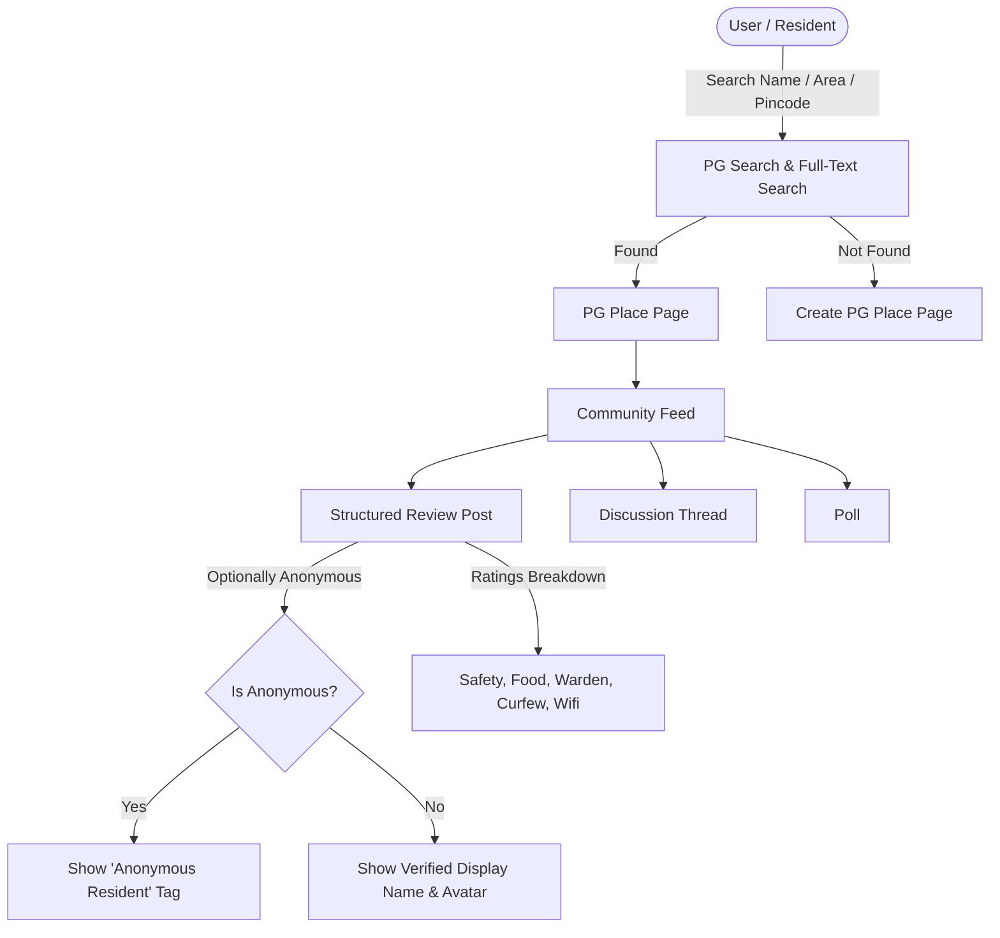
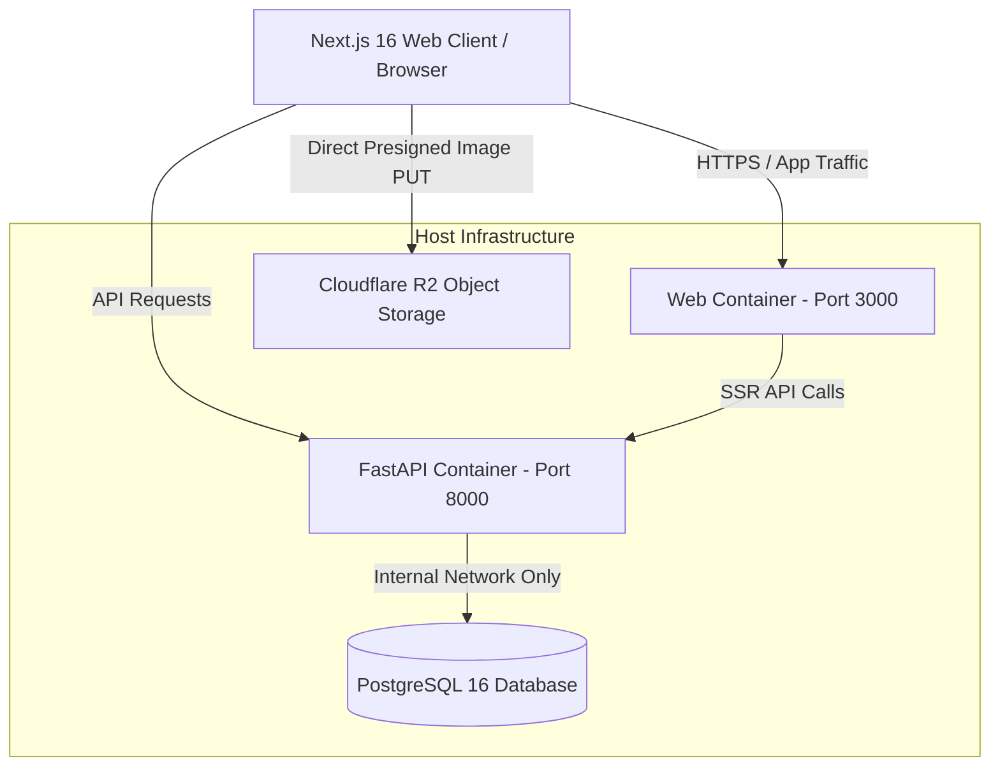
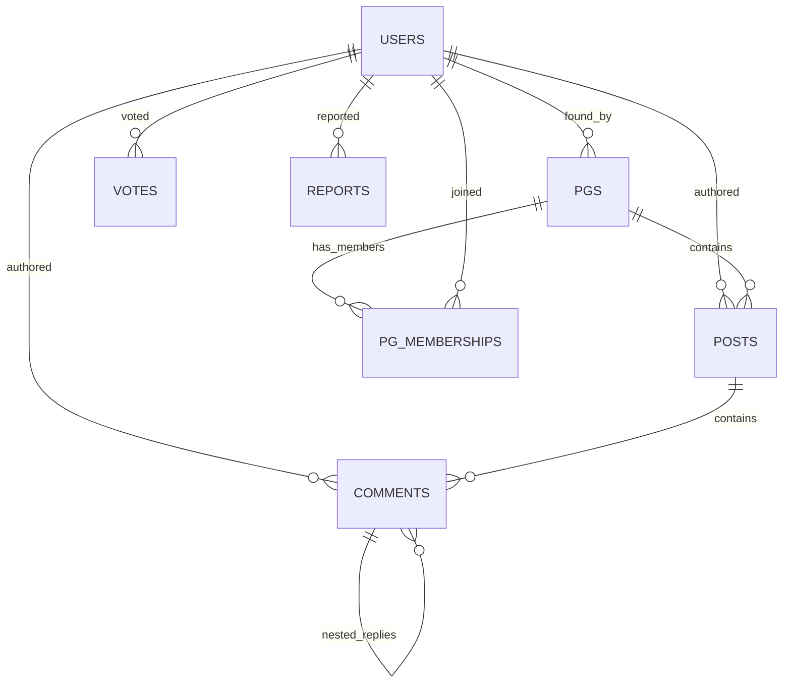

# SheStays Community — Complete Project Context & System Architecture

## 1. Executive Summary & Vision

**SheStays Community** is a specialized SaaS platform designed for women in Indian metro cities (starting with Chennai) to search for, review, and form trusted communities around **PG (Paying Guest) accommodations**. 

### The Problem It Solves
Women relocating for work or education face severe information asymmetry when choosing a PG. Official listings and photos omit critical living conditions—such as safety concerns, landlord/warden behavior, food quality, curfews, hygiene, and deposit refund disputes. Standard star reviews fail because reviewers fear retaliation if their identity is attached.

### The Solution
SheStays provides place-based community pages (similar to subreddits mapped to real-world addresses) where women can post **authentic, structured reviews** and **anonymous discussions** with zero leak of their real identity to other users or external preview notifications.

---

## 2. Core Concepts & Product Features



### 2.1 PG Search & Place Pages
- **Location Scope**: Chennai Metro launch zones (OMR-Sholinganallur, Thoraipakkam, Nungambakkam, Velachery, Anna Nagar).
- **Search Capabilities**: PostgreSQL Full-Text Search (`tsvector` + GIN index) by name, locality, address, or pincode with instant autocomplete.
- **Place Page Aggregates**: Displays PG name, area, address, aggregate star rating, member count, and review count updated dynamically via database triggers.

### 2.2 Structured Reviews & Discussions
- **Residency Claims**: Soft honesty prompts where users declare `"currently_here"` or `"stayed_here"`.
- **Category Rating Breakdown**: Detailed rating tags for **Safety**, **Food Quality**, **Warden Behavior**, **Curfew Rules**, and **Wi-Fi/Amenities**.
- **Threaded Comments**: Nested discussions with upvotes/downvotes.

### 2.3 Anonymous Posting & Strict Privacy Guarantees
- **Per-Post Anonymity Toggle**: Users choose whether to attach their public display name or post as `"Anonymous Resident"`.
- **Identity Isolation**: Anonymous posts never appear on a user's public or private profile.
- **Notification Privacy**: Push and email notifications for activity on anonymous posts use generic preview text (`"New reply on one of your posts"`) to prevent lock-screen identity leaks to shoulder-surfers or shared devices. Real details are only shown inside the authenticated in-app notification inbox.

### 2.4 Trust, Moderation & Women-Only Gate
- **Signup Gate**: Phone OTP verification + self-attestation.
- **Automated Content Filter**: Instant scanning for profanity and Indian PII (phone numbers `+91`, emails, street addresses, pincodes). Violating content is auto-flagged for moderation review.
- **Account Reputation Throttling**: Accounts younger than 24 hours are capped at 3 write actions per 24 hours to prevent spam and fake review brigading.

### 2.5 Cloudflare R2 Media Uploads
- **Direct Client Uploads**: Users can attach room, food, or bill proof photos. The backend generates presigned PUT URLs for **Cloudflare R2**, allowing images to bypass the backend server entirely to save bandwidth and compute.

---

## 3. System Architecture & Topology



### Network Isolation & Security Guarantees
- **Frontend Container (`apps/web`)**: Next.js 16 React app running on Port 3000. Communicates with backend via `shestays-frontend-network`.
- **Backend Container (`apps/api`)**: FastAPI (Python 3.12) REST service running on Port 8000. Connected to database via `shestays-database-network`.
- **Database Container (`database`)**: PostgreSQL 16. **No host port mapping exists** (5432 is strictly internal to Docker), preventing any external direct database exposure.

---

## 4. Repository Structure

```
glassdoor/
├── apps/
│   ├── api/                      # FastAPI Python Backend
│   │   ├── app/
│   │   │   ├── core/            # Configuration & Settings
│   │   │   ├── deps/            # Supabase & Auth Dependencies
│   │   │   ├── middleware/      # Rate Limiting, Error Handling, Security Headers
│   │   │   ├── routers/         # API Route Handlers (pg, post, comment, vote, report, upload)
│   │   │   ├── schemas/         # Pydantic v2 Request/Response Schemas
│   │   │   └── services/        # Content Filtering & Notifications
│   │   ├── tests/               # Pytest Test Suite
│   │   ├── Dockerfile           # Production Docker Setup
│   │   ├── main.py              # Application Entrypoint
│   │   └── pyproject.toml       # Dependencies & Tooling
│   │
│   └── web/                     # Next.js 16 Frontend
│       ├── src/                 # App Router Pages & Components
│       ├── public/              # Static Assets
│       ├── package.json
│       └── next.config.ts
│
├── database/
│   └── init-db.sql              # Schema Definition, FTS Triggers & Seed Data
│
├── docs/                        # Specifications & Engineering Guidelines
│   ├── PRD.md                   # Product Requirements Document
│   ├── TECH-STACK.md            # Technical Architecture Specifications
│   ├── DESIGN-SYSTEM.md         # UI/UX & Styling System
│   └── schema.sql               # Database Schema DDL
│
├── load-test.js                 # k6 Performance & Load Test Suite
├── docker-compose.yml           # Local Multi-Container Development Setup
└── PROJECT_OVERVIEW.md          # Comprehensive Context & Architecture Document (This File)
```

---

## 5. Database Schema & Data Models

### Key Database Tables



1. **`users`**: Stores user identity, display name, city, phone verification timestamp (`phone_verified_at`), and women attestation timestamp (`women_attested_at`).
2. **`pgs`**: Stores PG place pages (`name`, `area`, `address`, `founding_user_id`, `search_tsv`).
3. **`pg_memberships`**: Composite PK `(pg_id, user_id)` tracking community members.
4. **`posts`**: Core discussion/review table (`pg_id`, `author_id`, `is_anonymous`, `type`, `title`, `body`, `residency_claim`, `rating_tags`, `overall_rating`, `search_tsv`).
5. **`comments`**: Threaded comments (`post_id`, `parent_comment_id`, `author_id`, `is_anonymous`, `body`, `is_removed`).
6. **`votes`**: Unique votes `(user_id, target_type, target_id)` with direction (`+1`, `-1`).
7. **`reports`**: Moderation queue (`reporter_id`, `target_type`, `target_id`, `reason`, `detail`, `status`).
8. **`notifications`**: User activity alerts (`user_id`, `type`, `pg_id`, `post_id`, `was_anonymous`, `is_read`).

---

## 6. API Reference Overview

Base path: `/api/v1`

| Method | Endpoint | Description | Auth Required |
| :--- | :--- | :--- | :--- |
| `GET` | `/health` | API health check & DB readiness probe | ❌ No |
| `GET` | `/pgs` | List & filter PGs by area with cursor pagination | 🔒 Yes |
| `GET` | `/pgs/search` | Full-Text Search across PGs by keyword/locality | 🔒 Yes |
| `GET` | `/pgs/{pg_id}` | Retrieve single PG place page details & stats | 🔒 Yes |
| `POST` | `/pgs` | Create a new PG place page | 🔒 Yes |
| `GET` | `/pgs/{pg_id}/posts` | List posts for a PG (sorted by `new`, `top`, `discussed`) | 🔒 Yes |
| `POST` | `/pgs/{pg_id}/posts` | Create a review or discussion post (with anonymous toggle) | 🔒 Yes |
| `GET` | `/posts/{post_id}/comments` | Fetch threaded comments for a post | 🔒 Yes |
| `POST` | `/posts/{post_id}/comments` | Add a comment or nested reply | 🔒 Yes |
| `POST` | `/votes` | Cast or change upvote/downvote on post/comment | 🔒 Yes |
| `POST` | `/reports` | Report inappropriate content/harassment/doxxing | 🔒 Yes |
| `POST` | `/uploads/presigned-url` | Generate presigned PUT URL for Cloudflare R2 photo uploads | 🔒 Yes |
| `GET` | `/users/me` | Fetch authenticated user's private profile & activity | 🔒 Yes |

---

## 7. Performance & Scalability Design

- **Async Core**: FastAPI leverages Python `asyncio` to handle thousands of concurrent requests.
- **Cursor Pagination**: All feeds (`/pgs`, `/posts`, `/comments`) use cursor-based pagination (`created_at`, `upvotes`) to maintain $O(1)$ query time regardless of dataset size.
- **Postgres Full-Text Search**: Native `tsvector` columns and GIN indexes (`pgs_search_tsv_idx`, `posts_search_tsv_idx`) provide sub-millisecond search without external Elasticsearch overhead.
- **Cloudflare R2 Image Uploads**: Image binaries are uploaded directly from the browser to Cloudflare R2 object storage via presigned PUT URLs, preserving API bandwidth.
- **In-Memory & Redis Rate Limiting**: Request-rate limits protect the API against brute-force and DDoS attacks.

---

## 8. Verification & Local Development

### Running the API & Tests Locally

```bash
# 1. Start Docker services
docker compose up --build -d

# 2. Run backend pytest suite
docker compose exec backend pytest -v

# 3. Run load test (requires k6)
k6 run --vus 50 --duration 2m load-test.js
```
