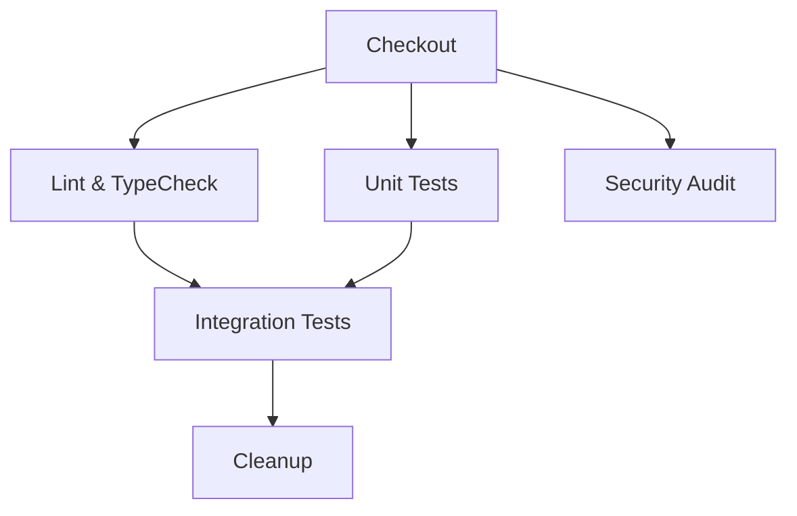

# SheStays Community

Repo structure and product decisions: see [docs/PRD.md](docs/PRD.md), [docs/TECH-STACK.md](docs/TECH-STACK.md), [docs/DESIGN-SYSTEM.md](docs/DESIGN-SYSTEM.md).

## Architecture Overview

This project implements a **production-ready Docker-based development and CI/CD architecture** with strict client-server separation and network isolation.

### Services

| Service | Technology | Port (Container) | Port (Host) | Purpose |
|---------|------------|------------------|-------------|---------|
| **Frontend** | Next.js 16 | 3000 | 3000 | React application with SSR |
| **Backend** | FastAPI (Python 3.12) | 8000 | — | REST API with JWT auth |
| **Database** | PostgreSQL 16 | 5432 | — | Local development data |

*Backend port 8000 is not published to the host. In local development, access it through the frontend proxy or `docker compose exec`.

### Network Topology

```
┌─────────────────────────────────────────────────────────────────┐
│                        HOST MACHINE                             │
│  ┌──────────────────┐         ┌──────────────────┐             │
│  │   Frontend       │ ─ proxy►│    Backend       │             │
│  │   (Port 3000)    │         │   (Port 8000)    │             │
│  └────────┬─────────┘         └────────┬─────────┘             │
│           │ frontend_network           │                        │
│           │                            │ database_network       │
│           ▼                            ▼                        │
│  ┌──────────────────────────────────────────────────┐           │
│  │              Database (Port 5432)                │           │
│  │              (NO host port mapping)              │           │
│  └──────────────────────────────────────────────────┘           │
└─────────────────────────────────────────────────────────────────┘
```

### Network Isolation Guarantees

- ✅ **Frontend** ↔ **Backend**: Connected via `shestays-frontend-network`
- ✅ **Backend** ↔ **Database**: Connected via `shestays-database-network` (internal)
- ✅ **Frontend** ↛ **Database**: No route exists; different networks
- ✅ **Database** ↛ **Host**: No published ports (5432 only internal)
- ✅ **Backend** ↛ **Host**: Port 8000 stays on the internal Compose network

---

## Quick Start (Local Development)

### Prerequisites

- Docker Desktop / Docker Engine + Docker Compose v2
- Node.js 20+ (for local frontend dev without Docker)
- Python 3.12 + Poetry (for local backend dev without Docker)

### 1. Configure Environment

```bash
# Copy the environment template
cp .env.example .env

# Edit local credentials (IMPORTANT: use a strong local-only password)
# Never commit .env to version control
vim .env
```

### 2. Validate Configuration

```bash
# Check Docker Compose configuration
docker compose config
```

### 3. Build and Start Services

```bash
# Build and start all services in background
docker compose up --build -d

# Check service status
docker compose ps

# View logs (all services)
docker compose logs -f

# View specific service logs
docker compose logs -f backend
docker compose logs -f database
```

### 4. Verify Services

```bash
# Frontend (browser)
open http://localhost:3000

# Backend health through the frontend proxy
curl http://localhost:3000/api/v1/healthz
# {"status":"ok"}

# Backend ready
curl http://localhost:3000/api/v1/ready
# {"status":"ready"}

# Database connectivity (from backend container)
docker compose exec backend pg_isready -h database -U app_local -d shestays_local
```

### 5. Run Tests Locally

```bash
# Backend tests (in container)
docker compose exec backend poetry run pytest -v

# Frontend tests (in container)
docker compose exec frontend npm run test:run -- --coverage

# Type checks
docker compose exec backend poetry run mypy app
docker compose exec frontend npm run typecheck
```

### 6. Stop Services

```bash
# Stop services (preserves database volume)
docker compose down

# Full reset (DESTRUCTIVE - deletes all local database data)
docker compose down -v
```

---

## Environment Configuration

### `.env.example` → `.env`

| Variable | Purpose | Local Default |
|----------|---------|---------------|
| `DB_USER` | PostgreSQL username | `app_local` |
| `DB_PASSWORD` | PostgreSQL password | **Must change** |
| `DB_NAME` | Database name | `shestays_local` |
| `DB_HOST` | Database hostname | `database` (internal) |
| `DB_PORT` | Database port | `5432` (internal) |
| `NEXT_PUBLIC_API_BASE_URL` | Same-origin API path used by the frontend | `/api/v1` |
| `API_INTERNAL_URL` | Backend URL used by the Next.js proxy inside Docker | `http://backend:8000` |

### API URL Behavior

| Context | URL Used | Resolves To |
|---------|----------|-------------|
| Browser (client components) | `/api/v1` | Next.js proxy → backend on the Compose network |
| Next.js proxy | `http://backend:8000/api/v1` | Internal Docker DNS |
| Backend → application data | `${SUPABASE_URL}` | Configured Supabase project |
| PostgreSQL service | `database:5432` | Local schema/seed service; current API routes use Supabase |

### Supabase Configuration (Local Development)

You have three options:

1. **Local Supabase** (`supabase start`): Update URLs to `http://localhost:54321`
2. **Dedicated Dev Project**: Use your dev project credentials
3. **Mock Mode**: Set `NEXT_PUBLIC_USE_LIVE_API=false` to use in-memory mock data

---

## Database Initialization

The database is automatically initialized on **first startup** via `/docker-entrypoint-initdb.d/init-db.sql`:

- ✅ Creates all tables with proper constraints, indexes, foreign keys
- ✅ Sets up full-text search (`tsvector` columns + GIN indexes + triggers)
- ✅ Seeds deterministic mock data (5 users, 5 PGs, posts, comments, votes, notifications)
- ✅ Runs only when data directory is empty (existing volumes preserved)

### Mock Data Includes

- **5 Users** (Priya, Anjali, Meera, Kavya, Divya)
- **5 PGs** across Chennai areas (OMR, Thoraipakkam, Nungambakkam, Velachery, Anna Nagar)
- **6 Posts** (3 reviews, 2 discussions, 1 poll)
- **4 Comments** with nested replies
- **5 Votes** on posts/comments
- **2 Notifications**

---

## CI/CD Pipeline

### Trigger

- Push to `main`
- Pull Request targeting `main`

### Workflow Stages



### Jobs

| Job | Timeout | Dependencies | Purpose |
|-----|---------|--------------|---------|
| `lint-and-typecheck` | 10m | — | ESLint, TypeScript, Ruff, MyPy |
| `unit-tests` | 15m | — | Vitest, Pytest |
| `integration-tests` | 20m | lint, unit | Full stack in Docker |
| `security-audit` | 10m | — | pip-audit, bandit, npm audit |
| `cleanup` | — | integration | Guaranteed cleanup |

### Integration Test Verification

The CI validates:

1. **Service Health**: All containers pass health checks
2. **Network Isolation**: Frontend→Backend✓, Backend→DB✓, Frontend→DB✗
3. **Port Exposure**: Database port 5432 NOT accessible from host
4. **API Endpoints**: Health, ready, and critical endpoints respond
5. **Test Suite**: Full backend/frontend test suites pass

---

## Security Boundaries

### Credential Management

- `.env` is **gitignored** — never committed
- `.env.example` contains **only placeholders** and local-safe defaults
- Production secrets **never** in CI; test credentials only
- Frontend bundles **never** contain database credentials
- Supabase service role key **backend-only**

### Container Security

- Non-root users in production stages
- `dumb-init` for proper signal handling
- Minimal base images (Alpine)
- Read-only mounts where possible
- Dropped capabilities (default Docker)

### Network Policies

- Database network is `internal: true`
- No host port mapping for PostgreSQL
- Backend port 8000 is not published to the host
- CORS restricted to `http://localhost:3000` in development

---

## Development Workflows

### Adding a New Dependency

**Frontend:**
```bash
cd apps/web
npm install <package>
# Or with Docker:
docker compose exec frontend npm install <package>
```

**Backend:**
```bash
cd apps/api
poetry add <package>
# Or with Docker:
docker compose exec backend poetry add <package>
```

### Database Migrations

For schema changes, create a new migration file and apply:

```bash
# Local: Apply manually or use migration tool
docker compose exec backend poetry run alembic upgrade head

# CI: Migrations run automatically during test startup
```

### Debugging

```bash
# Backend shell
docker compose exec backend sh

# Database shell
docker compose exec database psql -U app_local -d shestays_local

# Frontend shell
docker compose exec frontend sh

# View specific logs
docker compose logs --tail=100 backend
```

---

## Troubleshooting

### Services Won't Start

```bash
# Check logs
docker compose logs backend
docker compose logs database

# Verify .env exists and has valid values
cat .env

# Rebuild from scratch
docker compose down -v
docker compose up --build -d
```

### Database Connection Failed

```bash
# Check database health
docker compose exec database pg_isready -U app_local -d shestays_local

# Verify DATABASE_URL in backend
docker compose exec backend env | grep DATABASE_URL

# Check network connectivity
docker compose exec backend pg_isready -h database -U app_local -d shestays_local
```

### Port Conflicts

```bash
# Check what's using ports
lsof -i :3000
lsof -i :8000
lsof -i :5432

# Stop conflicting services or change ports in docker-compose.yml
```

### CI Fails Locally But Passes on GitHub

- Ensure Docker Desktop has enough resources (4GB+ RAM, 2+ CPUs)
- Check Docker Compose version (`docker compose version` ≥ v2.20)
- Verify no leftover containers: `docker system prune -f`

---

## File Structure

```
project-root/
├── .github/
│   └── workflows/
│       ├── ci.yml              # Main CI/CD pipeline
│       ├── ci-frontend.yml     # Frontend-specific CI (legacy)
│       └── ci-backend.yml      # Backend-specific CI (legacy)
├── apps/
│   ├── web/                    # Next.js Frontend
│   │   ├── Dockerfile
│   │   ├── package.json
│   │   ├── next.config.ts
│   │   └── src/
│   └── api/                    # FastAPI Backend
│       ├── Dockerfile
│       ├── pyproject.toml
│       ├── requirements.txt
│       ├── main.py
│       └── app/
├── database/
│   └── init-db.sql             # Schema + seed data
├── docker-compose.yml          # Service orchestration
├── .env.example                # Environment template
├── .gitignore
└── README.md
```

---

## Current State

- ✅ **Phases 1-5**: Frontend (Next.js), Backend (FastAPI), Database (PostgreSQL), Auth (Email OTP), Admin UI, Trust & Safety
- ✅ **Phases 6-7**: Search (FTS), Pagination, Load Testing, Security Headers, CI/CD, Deployment Configs, Sentry, Uptime Monitoring
- 🔄 **Next**: Legal review, Production deployment, Staging environment

---

## License

Private project — all rights reserved.
